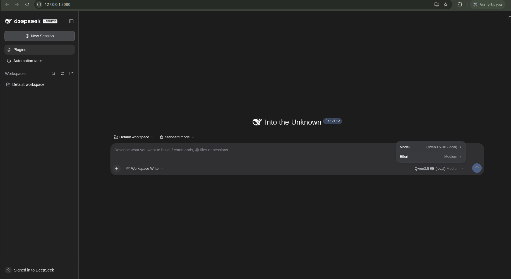

# HANSKA AI Launcher

## Screenshots




The first image shows the installed desktop shortcut; the second shows the local Harness web UI opened with the launcher.


## Screenshots


The first image shows the installed desktop shortcut; the second shows the local Harness web UI opened with the launcher.

A small Ubuntu desktop launcher for an existing local installation of the DeepSeek Harness web UI. It uses the user's existing NVM and offline `npx` cache; it does not install Node.js, Harness, Ollama, or npm packages.

## What it does

- Starts `@deepseek-ai/dsh web --no-open` from an existing project directory.
- Reuses a valid authenticated Harness server on `127.0.0.1:3080` instead of starting a second one.
- Stores launcher state in the user's private `~/.local/state/hanska-ai-launcher` directory.
- Hands the authenticated local URL to the browser through a one-time loopback redirect, avoiding token command-line arguments.
- Uses a lock to prevent duplicate launches and does not terminate existing processes.

The launch token must reach the browser so Harness can establish its session cookie. It may briefly appear in the browser's navigation history. Logs can contain credentials and must not be shared.

## Requirements

- Ubuntu or a compatible Linux desktop with `bash`, Python 3, `xdg-utils`, and optionally `zenity` for graphical error dialogs.
- An existing NVM setup and Node.js installation.
- An existing Harness project at `~/hanska-dsh-test`.
- `@deepseek-ai/dsh` already available offline through `npx`.

## Install

Install the Debian package from a local file:

```bash
sudo apt install ./hanska-ai-launcher_1.0.0-1_all.deb
```

Then open **HANSKA AI Launcher** from the applications menu. The installed launcher expects `start` at `/usr/lib/hanska-ai-launcher/start`.

## Safety and limitations

The launcher does not change Harness configuration, models, or project files. If another service occupies port 3080 and no valid launcher URL is available, it reports the conflict and exits. It does not kill processes. A server started outside the launcher requires its original authenticated URL.

The packaged version was validated with a simulated server for launch, reuse, token rejection, redirect behavior, and avoiding token arguments. Starting the user's real Harness installation was not verified as part of that validation.

## License

No open-source license is granted. All rights reserved by the copyright holder.
